<h1 align="center">Cell Counter</h1>

<p align="center">
  Counts the cells in your hemocytometer pictures for you.<br>
  Drag in your microscope pictures, check the count, get cells/mL. Nothing leaves your computer.
</p>

<p align="center">
  
  
  
  <a href="LICENSE"></a>
</p>

<p align="center">
  <strong>2.2 % average error per square &middot; no habit of over- or under-counting &middot; under 2 seconds per picture</strong><br>
  <sub>Checked against 15,624 hand-counted cells on 69 squares, using only squares the app had never seen before. Speed measured in the app itself, start to finish, 64 pictures on an ordinary laptop with no graphics card. <a href="#how-accurate-is-it">Details</a></sub>
</p>

<p align="center">
  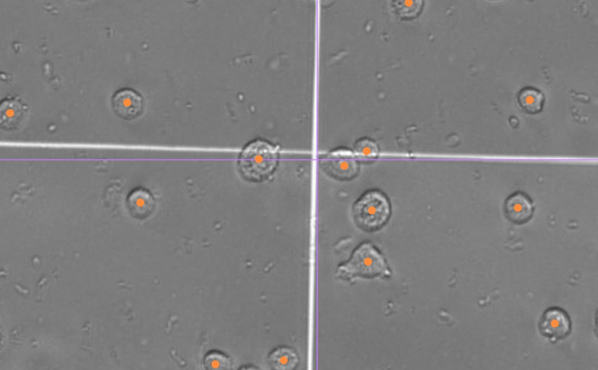
  <br><sub>Every cell the app counts gets an orange dot, so you can see exactly what it counted.</sub>
</p>

---

Counting a hemocytometer by hand is slow, tiring, and two people rarely get the
same number. **Cell Counter does it for you.** Give it the pictures from your
EVOS / AMG microscope at 10x, and in a minute or two you have a checked count
and a concentration in cells/mL.

- **Fast.** About 1 to 2 seconds per picture. A whole folder of 64 pictures takes under 2 minutes.
- **You stay in control.** Every counted cell is marked. If the app got one wrong, click to fix it.
- **Consistent.** The same picture gives the same count every time.
- **Private.** Everything happens on your own computer. No account, no upload, no internet needed.

## Contents

1. [How it works](#how-it-works)
2. [Install on a Mac](#install-on-a-mac) (or [on Windows](#install-on-windows))
3. [Name your pictures](#name-your-pictures)
4. [Count your cells, step by step](#count-your-cells-step-by-step)
5. [Save your results and close](#save-your-results-and-close)
6. [Taking good pictures](#taking-good-pictures)
7. [If something goes wrong](#if-something-goes-wrong)
8. [How accurate is it](#how-accurate-is-it)

## How it works

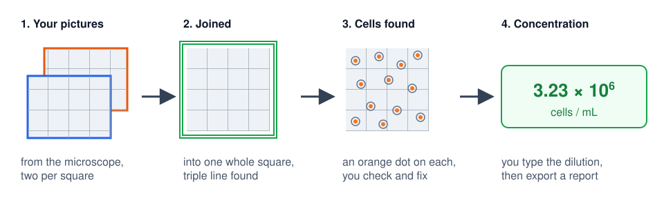

1. **You give it your pictures.** Straight from the microscope, a whole folder at once.
2. **It joins the two pictures of each square.** See below for why there are two.
3. **It finds every cell** inside the square's triple line and puts an orange dot on it.
   You look over the dots and fix any it got wrong.
4. **It works out cells/mL** once you type your dilution, and saves a report.

### Why each square needs two pictures

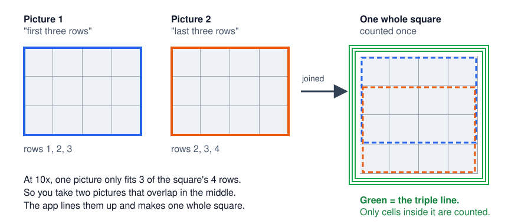

At 10x, the microscope's view is a little too short for a whole large square:
it fits 3 of the 4 rows. So for every square you take one picture of the **top
three rows** and one of the **bottom three rows**. The app finds which two
pictures belong together, lines them up, and counts the square **once**. Cells
in the middle, which show in both pictures, are not counted twice.

**The triple line** is the set of three close lines around each large square.
Only cells inside it are counted. This is the standard hemocytometer rule, and
the app applies it for you.

## Install on a Mac

You need **macOS 14 (Sonoma) or newer**. To check: click the **Apple menu** (the
apple logo at the top left of the screen) → **About This Mac**.

Nothing else to install, and no internet needed after the download.

1. **[Download Cell Counter for Mac](../../releases/latest/download/CellCounter-macOS.zip)**.
2. Open **Finder** (the blue smiling face in the Dock) and click **Downloads** in the left sidebar.
   - If you see **CellCounter-macOS.zip**, double-click it. A folder called **Cell Counter** appears.
   - If you already see the **Cell Counter** folder, Safari unzipped it for you.
3. **Drag the Cell Counter folder onto your Desktop.** Keep everything inside it together.
4. Open the folder. The first time only, macOS double-checks apps downloaded from the internet:

   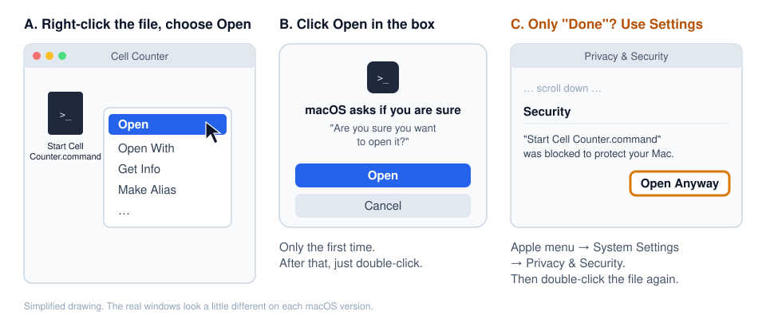

   - **A.** **Right-click** **Start Cell Counter.command** (or hold **Control** and click it). Choose **Open**.
   - **B.** A box asks if you are sure. Click **Open**.
   - **C.** If the box only offers **Done** (newer macOS does this): click **Done**, then
     **Apple menu** → **System Settings** → **Privacy & Security**. Scroll down to
     **Security** and click **Open Anyway** next to *"Start Cell Counter.command"*.
     Type your Mac password or use Touch ID. Then double-click the file again, and click **Open** if asked.
5. A **Terminal** window opens with a few lines of text. A moment later your web
   browser opens with the app:

   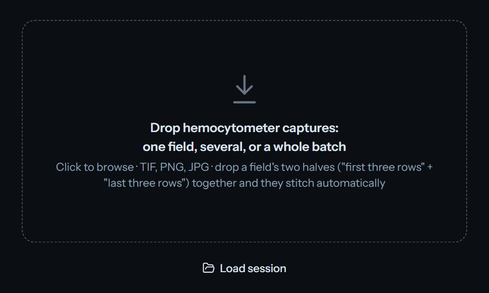

**From now on, just double-click Start Cell Counter.command.**

> [!IMPORTANT]
> **Leave the Terminal window open while you work.** It is the app's engine.
> Click the yellow button at its top left to tuck it into the Dock out of the way.

> [!TIP]
> **Start it from your Desktop or Dock.** Right-click *Start Cell Counter.command* → **Make Alias**.
> Drag the alias to your Desktop (or to the right-hand end of the Dock) and rename it *Cell Counter*.

<a id="install-on-windows"></a>
<details>
<summary><strong>Install on Windows</strong></summary>

Needs 64-bit Windows 10 or newer.

1. **[Download Cell Counter for Windows](../../releases/latest/download/CellCounter-Windows.zip)**.
2. Right-click the zip file, choose **Extract All**, then **Extract**.
   Do not open the app from inside the zip: it will not start from there.
3. Open the new folder and double-click **Start Cell Counter.bat**.
4. If a blue box says *Windows protected your PC*, click **More info**, then **Run anyway**. You only see this once.
5. A black window opens, then your browser opens with the app. The very first start can take about a minute.
   Keep the black window open while you work. Closing it quits the app.

Everywhere below, read **Ctrl** for **⌘ Command**.

</details>

## Name your pictures

Do this when you save the pictures at the microscope. It is optional, but it
keeps your samples apart and makes everything faster.

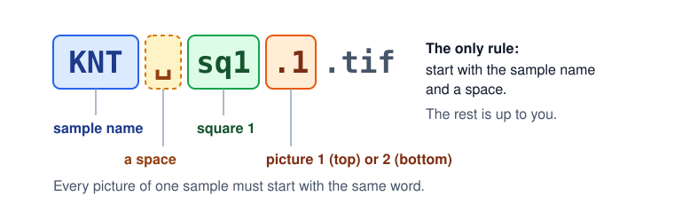

**Start every file name with the sample name, then a space.** After that, write anything. For example:

```text
KNT sq1.1.tif   KNT sq1.2.tif   KNT sq2.1.tif   KNT sq2.2.tif   ...
ha1 sq1.1.tif   ha1 sq1.2.tif   ha1 sq2.1.tif   ha1 sq2.2.tif   ...
```

Any sample name works (`KNT`, `ha1`, `tube3`), as long as every picture of that
sample starts with the same word and a space. Capital letters do not matter.
With names like these the app keeps each sample in its own group, only looks for
matching pairs inside one sample, and gives you cells/mL per sample.

## Count your cells, step by step

### Step 1. Drag in your pictures

1. Open the folder with your pictures in **Finder**.
2. Click one picture, then press **⌘ Command + A** to select them all.
3. Drag them onto the big box in the browser window. (Or click the box and pick the files.)

> [!TIP]
> Put the Finder window and the browser side by side, so you can drag from one to the other.

One picture goes straight to its count. Two or more show a **check screen** first:

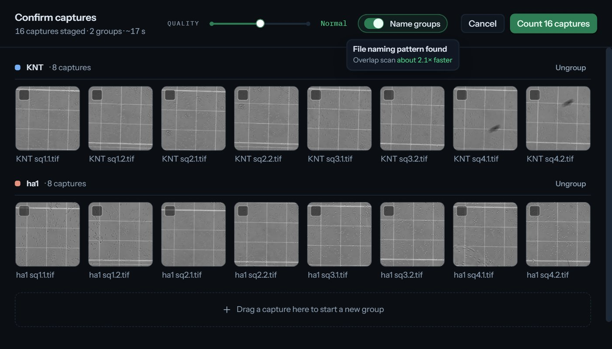

- Your pictures are sorted into **one row per sample** (here `KNT` and `ha1`).
  **Name groups** at the top turns this sorting on or off. It turns itself on when
  your file names follow the pattern above.
- **Quality** at the top: leave it on **Normal**. See [Quick, Normal or Finest](#quick-normal-or-finest).
- Files named another way can still be grouped by hand: tick the small box in the
  corner of each picture of one sample, then click **New group**.

Click the green **Count** button at the top right.

### Step 2. Confirm the pairs

The app finds the two pictures of each square and shows them joined:

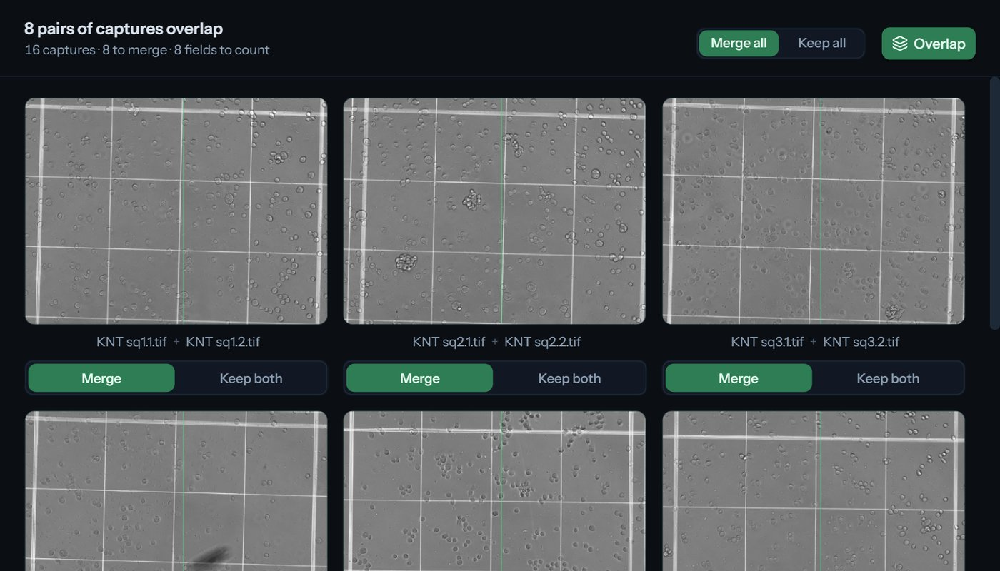

- Each card is one square made from two pictures. The thin green line is where they meet.
- **Merge** (already chosen) counts the pair as one square. This is almost always right.
- **Keep both** counts the two pictures separately. Use it only if the app paired up two different squares.

Click the green button at the top right. Counting starts, and you can watch it go:

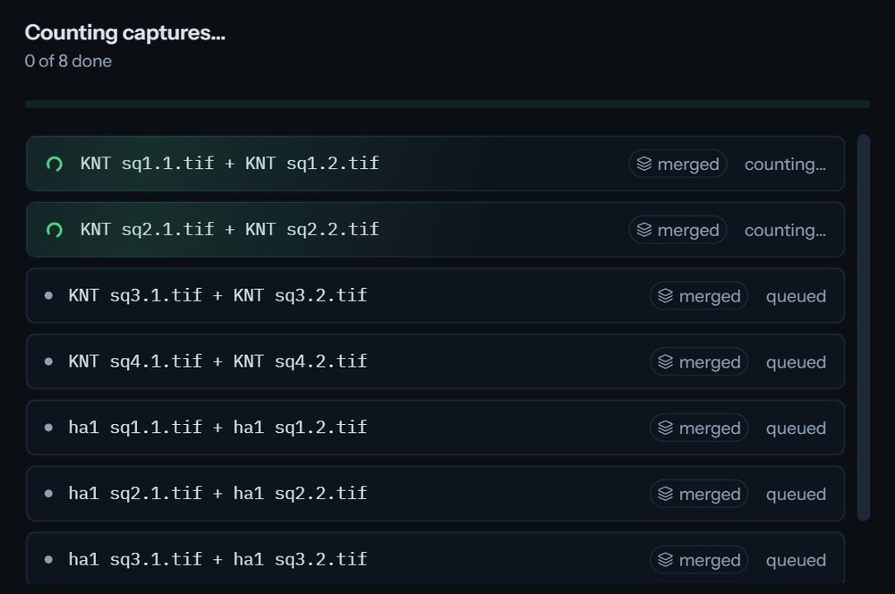

### Step 3. Look at the results

When counting finishes, every square is shown, grouped by sample:

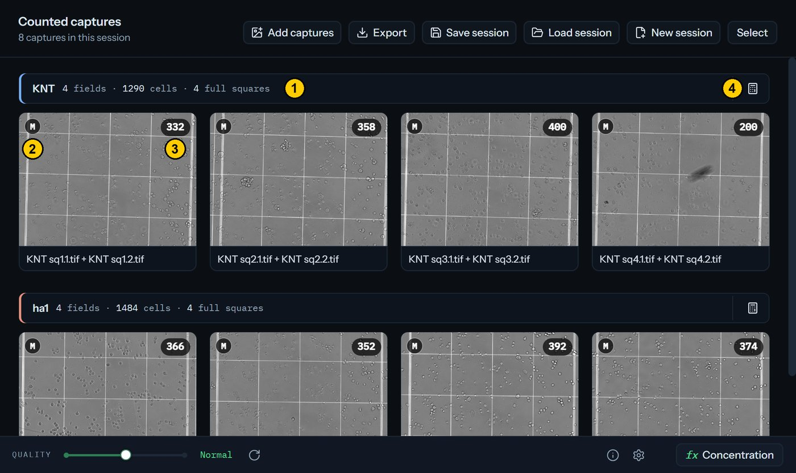

| | What it is |
| :-: | --- |
| **1** | **Sample summary:** the sample name, number of squares, total cells, and how many squares are complete. |
| **2** | **M** means the square was made by joining two pictures. |
| **3** | **The count** for that square. |
| **4** | **Calculator button** for this sample's cells/mL ([step 5](#step-5-get-cellsml)). |

Click any square to open it.

### Step 4. Check a square, and fix mistakes

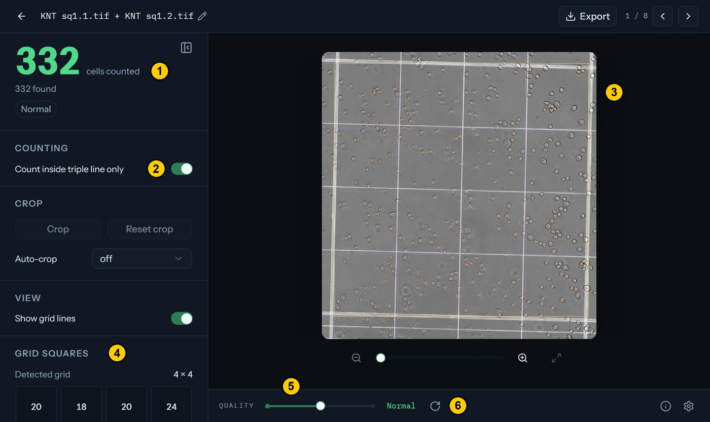

| | What it is |
| :-: | --- |
| **1** | **The count** for this square. It updates as you fix dots. |
| **2** | **Count inside triple line only.** Leave it on: it is the standard rule. |
| **3** | **The picture**, with an orange dot on every counted cell. |
| **4** | **Grid squares:** the count in each of the 16 small squares. Click one to **leave it out** (a bubble or debris in it, say). Click again to put it back. |
| **5** | **Quality** slider. |
| **6** | **Recount** button. Counts this picture again from scratch. |

Zoom in with the **+** button under the picture, or pinch out on the trackpad:


Every cell should have one dot.

- **A cell with no dot?** Click it to add a dot.
- **A dot on debris, or two dots on one cell?** Click the dot to remove it.

Your fixes stay when you zoom or crop. **The recount button (6) throws your fixes
away**, because it counts from scratch. Use the **arrows** at the top right (or
the ← → keys) for the next square, and the **back arrow** at the top left for all results.

#### Quick, Normal or Finest

The **Quality** slider at the bottom chooses how careful the count is.

| Setting | Per picture | 32 pictures (16 squares) | Use it for |
| --- | --- | --- | --- |
| Quick | 0.7 s | 13 s | a first look |
| **Normal** | **1.5 s** | **34 s** | **everyday counting (start here)** |
| Finest | 9.5 s | 4 min | final numbers, crowded slides |

<sub>Measured 2026-09-23 on a laptop CPU (Intel i7-14650HX), no graphics card. A smaller laptop will be slower.</sub>

**Moving the slider does not count anything.** Click the round **recount** button
next to it to count again at the new setting.

### Step 5. Get cells/mL

Click the **calculator button** on a sample's summary line, or **Concentration** at the bottom right.

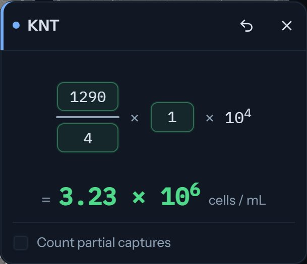

It does the standard hemocytometer sum:

> **cells/mL = (total cells ÷ number of squares) × dilution × 10⁴**

- **Top box:** total cells. **Box under it:** number of squares. The app fills both in.
- **Middle box: your dilution. Type it in.**
  Mixed 1 : 1 with trypan blue? Type **2**. Did not dilute? Leave it at **1**.
- **Green number:** your concentration. `3.23 × 10⁶` means 3,230,000 cells/mL.

Only **complete squares** are used. If a square is cut off (one of its two pictures
missing, say), the calculator leaves it out and tells you which one and why. Tick
**Count partial captures** only if you want those included anyway.

## Save your results and close

> [!WARNING]
> **Closing or reloading the browser tab clears all counts.** Export or save first.

Click **Export** at the top of the results page:

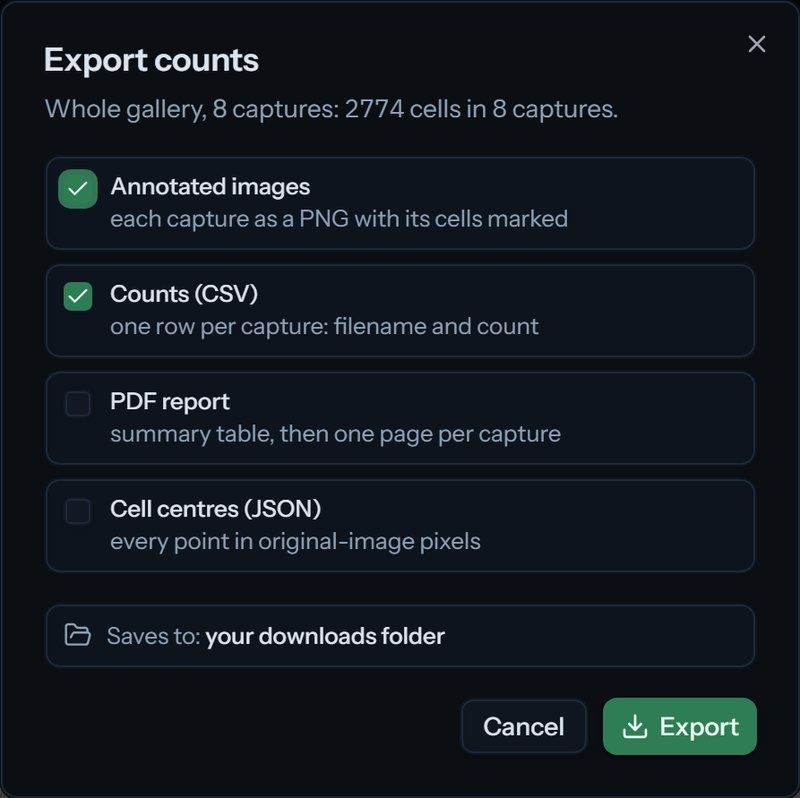

| Choice | What you get | Good for |
| --- | --- | --- |
| **Annotated images** | each picture with its dots drawn on | your lab notebook |
| **Counts (CSV)** | a table: file name and count | opening in Excel or Numbers |
| **PDF report** | a summary table, then one page per picture | printing, sharing |
| **Cell centres (JSON)** | the position of every dot | analysis software only |

Tick what you want and click **Export**. The files go to your **Downloads** folder.
Your browser may ask once whether to allow several downloads: click **Allow**.

**Save session** (top of the results page) keeps everything, fixes included, in one
file. Next time, click **Load session** on the start screen to carry on.

**To close the app:**

1. Close the browser tab.
2. Close the Terminal window with the red button at its top left.
3. Terminal asks *"Do you want to terminate running processes in this window?"*
   Click **Terminate**. That is normal: it is how the app stops.

## Taking good pictures

- **Focus on the cells**, not on the grid lines.
- **Keep the triple line in the picture.** It is the counting boundary. If the app cannot find it, it will not count that picture.
- **Keep the light even.** Bright or dark patches cause more mistakes than anything else.
- **Use 10x.** 4x is not tested.
- **Take two pictures per square:** the top three rows, then the bottom three rows.
- **Save the TIF** straight from the microscope. A re-saved JPG loses detail.

Made for EVOS / AMG 10x pictures: 8-bit grayscale TIF, 1360 × 1024, or a PNG / JPG export of one.

## If something goes wrong

| What you see | What to do |
| --- | --- |
| Mac says the file *cannot be opened* or is from an *unidentified developer* | Right-click it and choose **Open**, or use **Open Anyway** in Privacy & Security ([install step 4](#install-on-a-mac)). |
| The browser did not open | Open Safari (or any browser) and go to **<http://127.0.0.1:8477>** |
| Terminal says *Cell Counter stopped with an error* | Check the folder was unzipped and moved to the Desktop, then double-click again. |
| A picture says it could not be counted | The app could not find the grid or the triple line. Retake it with the triple line in view and in focus. |
| The app paired the wrong two pictures | Choose **Keep both** for that pair in [step 2](#step-2-confirm-the-pairs). Better: [name your pictures](#name-your-pictures) by sample. |
| A crowded square looks too low | Touching cells can be read as one. Zoom in and add the missing dots, or try **Finest**. |
| All my counts disappeared | The tab was closed or reloaded. Click **Load session** if you saved one, or count again. |

**Always look at the dots before you trust a number**, especially on an unusual
slide: lots of debris, dense clumps, uneven light, or cells sitting on grid lines.

## How accurate is it

The app learned to find cells from example pictures that people had counted by
hand. To test it fairly, whole batches of slides were kept hidden from it while
it learned. Its counts on those unseen squares were then compared with careful
hand counts. This was repeated 10 times, hiding a different batch each time.

| On squares it had never seen | Result |
| --- | --- |
| Average difference from the hand count, per square | **2.2 %** (about 5 cells on a typical 226-cell square) |
| Does it count too high or too low on average? | **+0.1 %**, so no |
| Worst single square | 7.6 % |
| Best and worst of the 10 hidden batches | 0.6 % to 3.6 % |
| Cell-by-cell agreement with the hand counts (F1 score, 1.0 = perfect) | 0.965 |

The second row matters most. A hemocytometer count averages several squares, so
a square counted a little high and another a little low cancel out. A count that
is *always* a little high would not cancel: it would go straight into your
cells/mL. Cell Counter does not lean either way.

Hand counts are not perfect either: people miss some pale cells, so part of
the difference is the hand count's mistake, not the app's.

### Known limits

- Very crowded or clumped squares count low. Two touching cells can be read as one.
- Pale or out-of-focus cells are missed more often than bright ones.
- If the app cannot find the grid or the triple line, it refuses to count that picture rather than guess. Take the picture again.
- Made and tested for 10x pictures only. 4x pictures are not tested.
- The app learned from a limited set of slides. Cells that look very different from those may count worse, and the app cannot warn you about that.

Full measurement history: [docs/accuracy-evidence.md](docs/accuracy-evidence.md) and the experiment log [ml/runs/loo.md](ml/runs/loo.md).

<details>
<summary><strong>For developers</strong></summary>

Running from source needs Python 3.12+ and Node. The launchers at the repo root
build a `.venv` on first run; the ones in a release zip carry their own Python.

```bash
pip install -r requirements.txt            # add requirements-train.txt to train
cd web && npm install && npm run build     # builds the UI into static/dist
python app.py                              # http://127.0.0.1:8477
```

```bash
python -m pytest                           # tests/{api,pipeline,ml,tools}
cd web && npm test
python tools/build_release.py              # release zips, needs internet
```

Tests marked `data` need annotated captures in `data/tif` and `data/gt`, which
are not published; they skip on a checkout without them.

Design history lives in [docs/](docs/). Accuracy claims use grouped
cross-validation (`python -m ml.loo`), never `score.py`, which scores the shipped
weights on their own training tiles.

</details>

## License

[MIT](LICENSE). Bundled fonts are under the [SIL Open Font License](web/public/fonts/OFL.txt).
